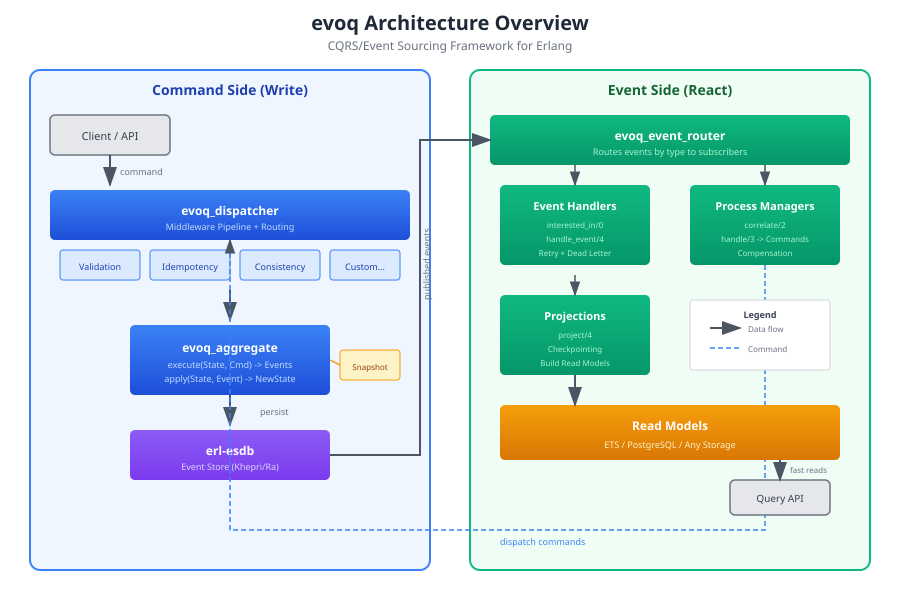

# evoq
[](https://github.com/sponsors/rgfaber)

Erlang CQRS/Event Sourcing framework built on reckon-db.



## Features

- Aggregate lifecycle with configurable TTL and passivation
- **Decisions (DCB)**: `evoq_decision` behaviour for cross-cutting consistency boundaries (uniqueness, allocation, rate limits) that lock on the absence of events matching a tag-filter rather than a single stream's version. See [guides/decisions.md](guides/decisions.md).
- **Decision context filters**: tag, `event_type`, and compound (`and_` / `or_`) leaves; each leaf reads its own index and is refined client-side. See [guides/decisions.md](guides/decisions.md#the-evoq_decision-behaviour).
- **CCC (Command Context Consistency)**: scope a Decision's boundary on opaque event-data fields (`payload_match` / `payload_hash_match`), not just tags, backed by reckon-db payload indexes. Fails loud when the index is undeclared. See [guides/decisions.md](guides/decisions.md#ccc-payload-conditions).
- **Stateful decision actor**: opt-in per-node `gen_server` (`boundary_key/1`) that serialises commands and caches the folded decision model for a keyed, hot boundary (one seat, one account, one SKU), avoiding `context_changed` retry thrash. The store stays the sole correctness authority. See [guides/decisions.md](guides/decisions.md#stateful-decision-actor-opt-in).
- **Lineage**: first-class correlation/causation/conversation API (`evoq_lineage`) over event metadata, with auto-propagation, mirroring the Enterprise Integration Patterns identifiers.
- Per-event-type subscriptions (not per-stream)
- Command idempotency
- Middleware pipeline for command dispatch
- Event handlers with retry strategies and dead letter support
- Process managers with compensation
- Projections with checkpointing
- Schema evolution via event upcasters
- Memory pressure monitoring with adaptive TTL
- Comprehensive telemetry integration

## Installation

Requires Erlang/OTP 28 (CI builds, tests and documents on 28.4.3).

Add to your `rebar.config`:

```erlang
{deps, [
    {evoq, "~> 1.30"}
]}.
```

### Versions

| Component | Version |
|---|---|
| `evoq` (this repo) | 1.26.1 |
| `telemetry` (dep) | 1.3.0 |
| Erlang/OTP | 27+ |

evoq is a standalone framework: it has **no** Reckon dependencies. `telemetry`
is its only runtime dependency. Pair it with any event store through an adapter
(see [guides/adapters.md](guides/adapters.md)); the [reckon-evoq](https://github.com/reckon-db-org/reckon-evoq)
adapter wires it to a Reckon store. The CCC payload-condition features require a
store and adapter that expose payload indexes (reckon-gater >= 3.7 /
reckon-db >= 5.3 via reckon-evoq >= 2.7), and *only* for decisions that use
payload leaves.

## Quick Start

### Defining an Aggregate

```erlang
-module(bank_account).
-behaviour(evoq_aggregate).

-export([init/1, execute/2, apply/2]).

init(_AccountId) ->
    {ok, #{balance => 0, status => active}}.

execute(#{status := closed}, _Command) ->
    {error, account_closed};
execute(_State, #{command_type := open_account, initial_balance := B}) ->
    {ok, [#{event_type => <<"AccountOpened">>, data => #{balance => B}}]};
execute(#{balance := Bal}, #{command_type := deposit, amount := A}) ->
    {ok, [#{event_type => <<"MoneyDeposited">>, data => #{amount => A}}]}.

apply(State, #{event_type := <<"AccountOpened">>, data := #{balance := B}}) ->
    State#{balance => B};
apply(#{balance := B} = State, #{event_type := <<"MoneyDeposited">>, data := #{amount := A}}) ->
    State#{balance => B + A}.
```

### Dispatching Commands

```erlang
%% Create a command
%% The aggregate id is also the id of the stream its events are stored in,
%% so on reckon-db it must be a valid stream id: <prefix>-<32 hex>. With
%% reckon-evoq, reckon_gater_stream_id:new(account) makes one. The rule:
%% https://hexdocs.pm/reckon_gater/stream_ids.html
Command = evoq_command:new(
    deposit,           %% command type
    bank_account,      %% aggregate module
    <<"account-018f6a7b8c9d4e5f60718293a4b5c6d8">>,     %% aggregate id
    #{amount => 100}   %% payload
),

%% Dispatch it
{ok, Version, Events} = evoq_router:dispatch(Command).
```

### Event Handlers

```erlang
-module(notification_handler).
-behaviour(evoq_event_handler).

-export([interested_in/0, init/1, handle_event/4]).

interested_in() ->
    [<<"AccountOpened">>, <<"LargeDeposit">>].

init(_Config) ->
    {ok, #{}}.

handle_event(<<"AccountOpened">>, Event, _Metadata, State) ->
    send_welcome_email(Event),
    {ok, State};
handle_event(<<"LargeDeposit">>, Event, _Metadata, State) ->
    send_deposit_alert(Event),
    {ok, State}.

%% The side effect is the handler's own: post the mail, page the operator,
%% publish a fact. Here it is a log line, so the example runs as it stands.
send_welcome_email(Event) ->
    logger:notice("welcome: ~p", [Event]),
    ok.

send_deposit_alert(Event) ->
    logger:warning("large deposit: ~p", [Event]),
    ok.
```

### Process Managers

```erlang
-module(order_fulfillment_pm).
-behaviour(evoq_process_manager).

-export([interested_in/0, correlate/2, handle/3, apply/2]).

interested_in() ->
    [<<"OrderPlaced">>, <<"PaymentReceived">>, <<"ItemShipped">>].

%% The last event of the process correlates as {stop, _}; anything else
%% as false, so correlate/2 never raises.
correlate(#{event_type := <<"ItemShipped">>, data := #{order_id := OrderId}}, _Meta) ->
    {stop, OrderId};
correlate(#{data := #{order_id := OrderId}}, _Meta) ->
    {continue, OrderId};
correlate(_Event, _Meta) ->
    false.

handle(State, #{event_type := <<"OrderPlaced">>, data := #{order_id := OrderId}}, _Meta) ->
    Cmd = evoq_command:new(process_payment, payment, OrderId, #{}),
    {ok, State, [Cmd]};
handle(State, #{event_type := <<"PaymentReceived">>, data := #{order_id := OrderId}}, _Meta) ->
    Cmd = evoq_command:new(ship_item, shipping, OrderId, #{}),
    {ok, State, [Cmd]};
handle(State, #{event_type := <<"ItemShipped">>}, _Meta) ->
    {ok, State#{status => completed}}.

apply(State, _Event) ->
    State.
```

### Projections

```erlang
-module(account_summary_projection).
-behaviour(evoq_projection).

-export([interested_in/0, init/1, project/4]).

interested_in() ->
    [<<"AccountOpened">>, <<"MoneyDeposited">>, <<"MoneyWithdrawn">>].

init(_Config) ->
    {ok, ReadModel} = evoq_read_model:new(evoq_read_model_ets, #{}),
    {ok, #{}, ReadModel}.

%% The read model is keyed on the account, which is the event's business
%% id. stream_id is the stream's name, so derive the entity from the data.
project(#{event_type := <<"AccountOpened">>, data := #{account_id := Id, balance := B}},
        _Metadata, State, ReadModel) ->
    {ok, NewRM} = evoq_read_model:put(Id, #{balance => B, tx_count => 0}, ReadModel),
    {ok, State, NewRM};
project(#{event_type := <<"MoneyDeposited">>, data := #{account_id := Id, amount := A}},
        _Metadata, State, ReadModel) ->
    {ok, Current} = evoq_read_model:get(Id, ReadModel),
    Updated = Current#{
        balance => maps:get(balance, Current) + A,
        tx_count => maps:get(tx_count, Current) + 1
    },
    {ok, NewRM} = evoq_read_model:put(Id, Updated, ReadModel),
    {ok, State, NewRM}.
```

## Core Behaviors

### Domain Artifacts

Domain artifacts stay inside the bounded context. They use atom keys and Erlang terms.

#### evoq_command

Commands represent intentions to change state. Formal contract for command modules.

```erlang
-behaviour(evoq_command).

%% Required
-callback command_type() -> atom().
-callback new(Params :: map()) -> {ok, Command :: term()} | {error, Reason :: term()}.
-callback to_map(Command :: term()) -> map().

%% Optional
-callback validate(Command :: term()) -> ok | {ok, Command :: term()} | {error, Reason :: term()}.
-callback from_map(Map :: map()) -> {ok, Command :: term()} | {error, Reason :: term()}.
```

#### evoq_event

Events represent facts that have happened. Immutable once stored.

```erlang
-behaviour(evoq_event).

%% Required
-callback event_type() -> atom() | binary().
-callback new(Params :: map()) -> Event :: term().
-callback to_map(Event :: term()) -> map().

%% Optional
-callback from_map(Map :: map()) -> {ok, Event :: term()} | {error, Reason :: term()}.
```

### Integration Artifacts

Integration artifacts cross bounded context boundaries. They use binary keys and are JSON-serializable.

#### evoq_fact

Facts translate domain events into payloads for external consumption via pg or mesh.

```erlang
-behaviour(evoq_fact).

%% Required
-callback fact_type() -> binary().          %% e.g., <<"ventures.venture_initiated">>
-callback from_event(EventType :: atom(), EventData :: map(), Metadata :: map()) ->
    {ok, Payload :: map()} | skip.

%% Optional (defaults use the OTP json module, in OTP since 27)
-callback serialize(Payload :: map()) -> {ok, binary()} | {error, Reason :: term()}.
-callback deserialize(Binary :: binary()) -> {ok, map()} | {error, Reason :: term()}.
-callback schema() -> map().
```

#### evoq_hope

Hopes are outbound RPC requests between agents. Unlike facts (fire-and-forget), hopes expect a response.

```erlang
-behaviour(evoq_hope).

%% Required
-callback hope_type() -> binary().
-callback new(Params :: map()) -> {ok, Hope :: term()} | {error, Reason :: term()}.
-callback to_payload(Hope :: term()) -> map().
-callback from_payload(Payload :: map()) -> {ok, Hope :: term()} | {error, Reason :: term()}.

%% Optional
-callback validate(Hope :: term()) -> ok | {error, Reason :: term()}.
```

See [Artifacts Guide](guides/artifacts.md) for detailed documentation and examples.

### evoq_aggregate

Aggregates maintain business invariants and produce events.

```erlang
-callback init(AggregateId :: binary()) -> {ok, State :: term()}.
-callback execute(State :: term(), Command :: map()) ->
    {ok, [Event :: map()]} | {error, Reason :: term()}.
-callback apply(State :: term(), Event :: map()) -> NewState :: term().

%% Optional: the evoq_state module the aggregate delegates to (never called)
-callback state_module() -> module().

%% Optional: snapshotting
-callback snapshot(State :: term()) -> SnapshotData :: term().
-callback from_snapshot(SnapshotData :: term()) -> State :: term().
```

### evoq_aggregate_lifespan

Controls aggregate lifecycle (TTL, passivation).

```erlang
-type action() :: timeout() | infinity | hibernate | stop.

-callback after_event(Event :: map()) -> action().
-callback after_command(Command :: map()) -> action().
-callback after_error(Error :: term()) -> action().
-callback on_timeout(State :: term()) -> {ok, action()} | {snapshot, action()}.
```

Default: 30-minute idle timeout, snapshot on passivation.

### evoq_event_handler

Subscribe to events by type (not by stream).

```erlang
-callback interested_in() -> [EventType :: binary()].
-callback init(Config :: map()) -> {ok, State :: term()} | {error, Reason :: term()}.
-callback handle_event(EventType :: binary(), Event :: map(),
                       Metadata :: map(), State :: term()) ->
    {ok, NewState :: term()} | {error, Reason :: term()}.
%% Optional: skip for a handler with side effects, see guides/event_handlers.md
-callback replay_policy() -> skip | deliver.
```

### evoq_process_manager

Coordinate long-running business processes.

```erlang
-callback interested_in() -> [EventType :: binary()].
-callback correlate(Event :: map(), Metadata :: map()) ->
    {start | continue | stop, ProcessId :: binary()} | false.
-callback handle(State :: term(), Event :: map(), Metadata :: map()) ->
    {ok, NewState :: term()} |
    {ok, NewState :: term(), Commands :: [#evoq_command{}]} |
    {error, Reason :: term()}.
-callback apply(State :: term(), Event :: map()) -> NewState :: term().

%% Optional: compensation for a failed command
-callback compensate(State :: term(), FailedCommand :: #evoq_command{}) ->
    {ok, [CompensatingCommand :: #evoq_command{}]} | skip.
```

### evoq_projection

Build read models from events.

```erlang
-callback interested_in() -> [EventType :: binary()].
-callback init(Config :: map()) ->
    {ok, State :: term(), ReadModel :: evoq_read_model:read_model()} |
    {error, Reason :: term()}.
-callback project(Event :: map(), Metadata :: map(),
                  State :: term(), ReadModel :: evoq_read_model:read_model()) ->
    {ok, NewState :: term(), NewReadModel :: evoq_read_model:read_model()} |
    {skip, State :: term(), ReadModel :: evoq_read_model:read_model()}.
```

### evoq_middleware

Intercept command dispatch.

```erlang
-callback before_dispatch(Pipeline :: #evoq_pipeline{}) -> #evoq_pipeline{}.
-callback after_dispatch(Pipeline :: #evoq_pipeline{}) -> #evoq_pipeline{}.
-callback after_failure(Pipeline :: #evoq_pipeline{}) -> #evoq_pipeline{}.
```

## Configuration

```erlang
%% sys.config
[{evoq, [
    {store_id, my_store},

    {aggregate_defaults, #{
        idle_timeout => 1800000,    %% 30 minutes
        hibernate_after => 60000,   %% 1 minute
        snapshot_every => 100       %% events
    }},

    {aggregate_partitions, 4},

    {memory_monitor, #{
        check_interval => 10000,    %% 10 seconds
        elevated_threshold => 0.70,
        critical_threshold => 0.85
    }}
]}].
```

Consistency is a dispatch option, not application config and not a handler
option: `evoq_router:dispatch(Command, #{consistency => strong})` waits for
every event handler and projection subscribed to the events the command
appended to have written them, and `#{consistency => {handlers, [...]}}`
waits for those alone. Only a write is acknowledged: a handler whose own
error policy dropped the event answers the dispatch
`{error, {consistency_dropped, Handler}}` instead. See the consistency
section of `guides/event_handlers.md` for what is and is not in the wait.

## Memory Pressure Handling

The memory monitor adjusts aggregate TTLs based on system memory usage:

| Pressure Level | Memory Usage | TTL Factor |
|----------------|--------------|------------|
| normal         | < 70%        | 1.0x       |
| elevated       | 70-85%       | 0.5x       |
| critical       | > 85%        | 0.1x       |

## Telemetry Events

All events follow the pattern: `[evoq, component, action, stage]`

Units follow telemetry's convention (since 1.26.1): a `duration` is elapsed
time from the monotonic clock in **native** units, and a `system_time` is
wall-clock time in native units. Convert with
`erlang:convert_time_unit(D, native, millisecond)`. The one exception is
`delay` on `[evoq, handler, retry]`, which is milliseconds, the unit of the
retry backoff.

### Aggregate Events
- `[evoq, aggregate, execute, start | stop | exception]`
- `[evoq, aggregate, init | hibernate | passivate | activate]`
- `[evoq, aggregate, snapshot, save | load]`

### Handler Events
- `[evoq, handler, start | stop | exception]`
- `[evoq, handler, event, start | stop | exception]`
- `[evoq, handler, retry | dead_letter]`

### Process Manager Events
- `[evoq, process_manager, start | stop]`
- `[evoq, process_manager, command | compensate]`
- `[evoq, process_manager, exception]` - a process manager raised; the event is a dead letter

### Projection Events
- `[evoq, projection, start | stop | exception]`
- `[evoq, projection, event]` - one event handed to the projection
- `[evoq, projection, halted]` - the projection could not catch up (or a
  rebuild could not finish) and is now refusing events until it is rebuilt;
  the `error` metadata says why
- `[evoq, projection, checkpoint]` - a checkpoint was saved; its position is
  the projection's progress, so a stalled projection is visible here

## Testing

```bash
# Unit tests
rebar3 eunit --dir=test/unit

# Integration tests
rebar3 ct

# Dialyzer
rebar3 dialyzer

# All tests with coverage
rebar3 do eunit, ct, cover
```

## Key Design Decisions

### Per-Event-Type Subscriptions

Unlike stream-based subscriptions, evoq subscribes by event type. This prevents subscription explosion when you have millions of aggregates.

### Default TTL (Not Infinity!)

Aggregates have a 30-minute default idle timeout. This prevents unbounded memory growth that occurs with infinite lifespan defaults.

### Partitioned Supervision

Aggregates are distributed across 4 partition supervisors using consistent hashing, preventing single-supervisor bottlenecks.

## Documentation

The full, grouped guide index with suggested reading orders lives in
[guides/README.md](guides/README.md). Highlights:

- [Architecture Overview](guides/architecture.md) - How the components work together
- [Aggregates](guides/aggregates.md) - Building domain models with event sourcing
- [Event Handlers](guides/event_handlers.md) - Reacting to events with side effects
- [Process Managers](guides/process_managers.md) - Coordinating long-running workflows
- [Projections](guides/projections.md) - Building optimized read models
- [Decisions (DCB/CCC)](guides/decisions.md) - Cross-cutting consistency boundaries and the stateful decision actor
- [Adapters](guides/adapters.md) - Integrating with different event stores

## Reckon stack

evoq is one library in the Reckon event-sourcing ecosystem. In dependency order (a library only knows about the ones above it):

- **[reckon-proto](https://github.com/reckon-db-org/reckon-proto)**: the wire-contract protobufs; source of truth for the gateway surface.
- **[reckon-gater](https://github.com/reckon-db-org/reckon-gater)**: shared types and protocols; no Reckon dependencies.
- **[reckon-db](https://github.com/reckon-db-org/reckon-db)**: BEAM-native event store. Depends on reckon_gater, khepri, ra.
- **[reckon-nifs](https://github.com/reckon-db-org/reckon-nifs)**: standalone Rust NIF helpers with pure-Erlang fallbacks.
- **evoq (this repo)**: standalone CQRS/event-sourcing framework (aggregates, projections, process managers, middleware pipeline, decisions/DCB/CCC). No Reckon dependencies; pairs with any store via an adapter.
- **[reckon-evoq](https://github.com/reckon-db-org/reckon-evoq)**: adapter wiring evoq to a Reckon store. Depends on evoq and reckon_gater; not on reckon_db (reaches the store through the gater API).
- **[reckon-gateway](https://github.com/reckon-db-org/reckon-gateway)**: gRPC + HTTP/JSON ingress. Consumes reckon_gater; can embed reckon_db or federate remote clusters.
- **[reckon-go](https://github.com/reckon-db-org/reckon-go)**: the Go client; talks to reckon-gateway.
- **reckon-portal**: docs and landing site ([reckon-internal/reckon-portal](https://github.com/reckon-db-org/reckon-portal)).

## License

Apache-2.0
