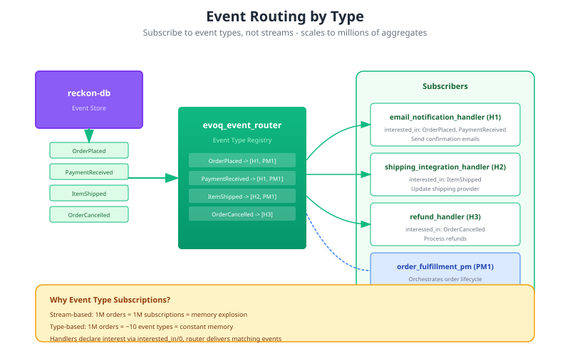

# Event Handlers

Event handlers react to domain events with side effects. They enable loose coupling between the core domain and external concerns like notifications, integrations, and analytics.



## When to Use Event Handlers

Use event handlers for:

- **Notifications** - Send emails, SMS, push notifications
- **External integrations** - Update external systems, APIs
- **Analytics** - Track metrics, log events
- **Side effects** - Anything that doesn't affect domain state

Do **not** use event handlers for:
- Updating aggregate state (use `apply/2`)
- Building read models (use projections)
- Coordinating workflows (use process managers)

## Basic Event Handler

```erlang
-module(email_notification_handler).
-behaviour(evoq_event_handler).

-export([interested_in/0, init/1, handle_event/4]).

%% Declare which event types to receive
interested_in() ->
    [<<"UserRegistered">>, <<"PasswordReset">>, <<"OrderShipped">>].

%% Initialize handler state
init(_Config) ->
    {ok, #{email_service => email_client:connect()}}.

%% Handle each event
handle_event(<<"UserRegistered">>, Event, _Metadata, State) ->
    #{email := Email, name := Name} = maps:get(data, Event),
    notify(welcome, [Email, Name]),
    {ok, State};

handle_event(<<"PasswordReset">>, Event, _Metadata, State) ->
    #{email := Email, token := Token} = maps:get(data, Event),
    notify(password_reset, [Email, Token]),
    {ok, State};

handle_event(<<"OrderShipped">>, Event, Metadata, State) ->
    #{order_id := OrderId, tracking := Tracking} = maps:get(data, Event),
    CustomerEmail = lookup_customer_email(OrderId),
    notify(shipping, [CustomerEmail, Tracking]),
    {ok, State}.

%% The side effects are yours: hand these to the mail service you keep in
%% the handler's state. A log line stands in, so the example runs as it
%% stands.
notify(What, Args) ->
    logger:notice("~p: ~p", [What, Args]),
    ok.

lookup_customer_email(OrderId) ->
    %% Your read model, or the customer service's API.
    logger:notice("email for ~p", [OrderId]),
    undefined.
```

## Required Callbacks

### interested_in/0

Declare which event types this handler wants to receive:

```erlang
-spec interested_in() -> [EventType :: binary()].

interested_in() ->
    [<<"OrderPlaced">>, <<"OrderCancelled">>].
```

The event router only delivers matching events, reducing overhead.

### init/1

Initialize handler state on startup:

```erlang
-spec init(Config :: map()) -> {ok, State :: term()} | {error, Reason :: term()}.

init(Config) ->
    ApiKey = maps:get(api_key, Config),
    Client = external_service:connect(ApiKey),
    {ok, #{client => Client, retry_count => 0}}.
```

### handle_event/4

Process a single event:

```erlang
-spec handle_event(EventType :: binary(), Event :: map(), Metadata :: map(), State :: term()) ->
    {ok, NewState :: term()} | {error, Reason :: term()}.

handle_event(EventType, Event, Metadata, State) ->
    %% EventType: <<"order_placed_v1">>
    %% Event: #{event_type => ..., data => ..., ...}
    %% Metadata: the delivered routing keys, see "What the handler is handed"
    %% State: Handler's internal state

    do_side_effect(Event),
    {ok, State}.
```

## Restarts and Replay

`evoq_store_subscription` rescans the whole event store every time a node
boots, so handlers and projections that keep their state in memory can
rebuild it. Events the node had already consumed before it went down come
around again as **replay**, with `replaying => true` in the metadata. Events
appended while the node was down have never been delivered and arrive
without that key, exactly like live events.

The boundary is the store subscription's persisted checkpoint: how far this
node had consumed the store when it stopped.

A handler with side effects (publishing to the mesh, sending mail,
calling an external API) must not repeat them for replay. Declare it:

```erlang
-export([interested_in/0, init/1, handle_event/4, replay_policy/0]).

replay_policy() -> skip.
```

A handler rebuilding in-memory state from history wants replay:

```erlang
replay_policy() -> deliver.
```

Not declaring it delivers replay, as before `replay_policy/0` existed, and
logs one warning per boot naming the handler the first time it is handed
replay (`what => evoq_handler_received_replay_without_policy`). A handler
with side effects and no policy is the one that warning exists to find.

A handler can also read the flag itself, `maps:get(replaying, Metadata,
false)`, for a decision finer than the whole handler.

A handler that starts after the store subscription (an application that
boots later, or a handler the supervisor restarts) gets its history first,
to itself alone, then the live events: each event once, in store order. A
restarted handler is the same consumer as before, recognised by its module
and Config. Everything this boot already routed to its last incarnation
reaches it as replay. Two instances of one module with different Configs
are two consumers. A Config that holds a pid or a ref differs on every
restart: start such a handler with `evoq_event_handler:start_link(Module,
Config, #{identity => Name})`.

Limits:

- The checkpoint is acknowledged every 200 events and on a clean stop.
  After a **crash**, up to 199 events delivered since the last
  acknowledgement arrive as new again. Exactly-once would need a
  checkpoint per handler.
- A handler that crashes is handed, as replay, the events in flight to it
  when it died: at-most-once for those, around the crash, as for the
  node's own replay.
- A node whose persisted checkpoint was never moved (evoq before 1.23.3
  never acknowledged it) sees its whole history as new one more time, on
  its first boot with 1.24.0.

## Messages to the Handler Process

A handler runs in its own process. Anything sent to that process other than
an event, most usefully a message the handler scheduled to itself from
`handle_event/4`, goes to the optional `handle_info/2`, with gen_server's
shape:

```erlang
handle_event(_Type, Event, _Meta, State) ->
    publish_or_retry(Event, 0),
    {ok, State}.

handle_info({retry, Attempt, Event}, State) ->
    publish_or_retry(Event, Attempt),
    {noreply, State}.

publish_or_retry(Event, Attempt) ->
    case publish(Event) of
        ok -> ok;
        {error, _} -> erlang:send_after(5000, self(), {retry, Attempt + 1, Event})
    end.
```

`{stop, Reason, NewState}` stops the handler. A handler without
`handle_info/2` that is sent a message logs a warning naming itself and the
message (`what => evoq_handler_has_no_handle_info`).

## Retry Strategies

Event handlers can fail (network issues, service unavailable). evoq supports retry strategies:

```erlang
-module(my_handler).
-behaviour(evoq_event_handler).

-include_lib("evoq/include/evoq.hrl").

-export([interested_in/0, init/1, handle_event/4, on_error/4]).

interested_in() ->
    [<<"OrderShipped">>].

init(_Config) ->
    {ok, #{}}.

%% Optional: decide what happens on a failure.
%%
%% This REPLACES the framework's default policy, including its retry cap:
%% max_retries/0 and backoff_ms/1 are only read when on_error/4 is absent.
%% An on_error/4 that always answers `retry' retries forever, inside the
%% handler's gen_server, holding up every event behind it.
on_error(Reason, _Event, #evoq_failure_context{attempt_number = Attempt}, _State) ->
    case Attempt >= 3 of
        true -> {dead_letter, Reason};      %% give up, keep it for an operator
        false -> {retry, 1000 * Attempt}    %% 1s, then 2s
    end.

handle_event(EventType, Event, _Meta, State) ->
    case call_external_api(Event) of
        {ok, _} -> {ok, State};
        {error, temporary} -> {error, temporary};  %% on_error/4 decides
        {error, permanent} -> {ok, State}          %% Don't retry, mark as handled
    end.

%% Your call to the outside world: the answer is what on_error/4 acts on.
call_external_api(Event) ->
    logger:notice("calling out for ~p", [Event]),
    {ok, Event}.
```

`on_error/4` returns the action: `retry`, `{retry, DelayMs}`, `skip`,
`stop` or `{dead_letter, Reason}`, and it is used **as given**. Without
`on_error/4` the framework backs off (`evoq_retry_strategy`) up to
`max_retries/0` attempts, then dead-letters the event; that default is the
only thing `max_retries/0` and `backoff_ms/1` change. There is no
`retry_strategy/0` callback.

Two of those actions are worth thinking about before you pick one:

- `{retry, DelayMs}` sleeps in the handler's process. Every event behind it
  waits, and the store subscription's ack waits with them.
- `stop` ends the handler. It comes back at its checkpoint, but the node's
  shared `$all` subscription has already moved past the event, so the feed
  does not deliver it again. A **projection** with a checkpoint store
  replays what it missed when it restarts (see `projections.md`); a plain
  event handler does not replay on its own, so it is a fresh handler you
  start from the position you choose.

## Dead Letter Queue

Events that fail after all retries go to the dead letter queue:

```erlang
%% An operator reads the queue, then either retries one entry or drops it.
%%
%% retry/1 only looks the entry up: it answers the event and the handler
%% that gave up on it, and leaves the entry in the queue. Re-running the
%% handler is the operator's step, and delete/1 is what clears the entry
%% once that has worked.
Failed = evoq_dead_letter:list(),
Pending = evoq_dead_letter:count(),
{ok, Event, Handler} = evoq_dead_letter:retry(EventId),
ok = evoq_event_handler:notify(HandlerPid, EventType, Event, Metadata),
ok = evoq_dead_letter:delete(EventId).
```

Dead letters include:
- Original event
- Handler name
- Failure reason
- Number of attempts
- Timestamps

## Consistency

Consistency is a property of the **dispatch**, not of the handler. A
handler does not declare it and `start_link/3` does not take it: by the time
a handler sees an event, the dispatch that produced it is already over.

```erlang
%% Default: the command returns as soon as the events are appended.
%% The handler catches up on its own.
{ok, Version, Events} = evoq_router:dispatch(Command).

%% Wait for named handlers to ack the events this command produced.
{ok, Version, Events} =
    evoq_router:dispatch(Command, #{consistency => {handlers, [audit_handler]}}).
```

| Option | What it waits for |
|--------|-------------------|
| `eventual` (default) | nothing - the command returns once the events are appended |
| `{handlers, Handlers}` | those handlers and projections, up to their acks on the version this dispatch produced, then returns |
| `strong` | every event handler and projection subscribed to the event types the command appended, on this node, each up to its ack of the event it was handed |

`strong` derives its set from the appended events and the event type
registry, the same lookup the event router delivers by: nothing keeps a list,
and a handler that registers later is in the set from the moment it
registers. When nothing subscribes to what was appended there is nothing that
could be behind it, so the dispatch answers at once rather than waiting out
the timeout.

**Each handler answers at its own version.** A dispatch that appends two
events reaches the handler of the first with version 1 and the handler of the
second with version 2, and each acknowledges the version it was handed. A
handler held to the append's last version would never answer, because it was
never given that event, and every multi-event dispatch would end at the
deadline. A handler subscribed to both events answers at the later one.

The waiter joins the stream's group **before** the append, so a handler fast
enough to finish before the router gets back from the append still has its
acknowledgment counted. The ack carries the event's own stream version: a
handler already past it answers for it, one behind it does not.

What `strong` does **not** wait for is a process manager instance. Which
instances handle an event is decided at delivery time (`correlate/2`, which
may start one), so the set does not exist when the command is dispatched. A
process manager that needs its own writes seen dispatches and waits itself.

**A handler that dispatches must not wait, with `strong`, for the handlers of
its own event.** A cascade written as an `evoq_event_handler` (a module with
`interested_in/0`, which the event type registry does hold, unlike a process
manager instance) is itself one of the handlers the dispatch that triggered it
is waiting for. If it dispatches a command with `strong`, it waits for the
read models of the events it just appended while still holding the event it
has not finished, and one of those read models may be the projection busy with
that very event.

Two things keep this from being a trap. The calling process is never in its
own required set: `await/4` drops `self()`, so a dispatcher cannot wait for an
ack it owes, and every other handler is still waited for. And a cascade
dispatches `:eventual` regardless, because it does not read its own write; the
entry-point dispatch that triggered it is the one that asked for the
guarantee. (Macula-realm found the shape with a membership's revocation: the
manager that ends the person's clients subscribed to the same event type its
cascade appends.)

A wait that times out answers `{error, consistency_timeout}` rather than
`{ok, ...}`: the command's events are appended either way, so a caller must
treat that error as "written, but not yet seen by those handlers". The wait
follows the dispatch's `timeout` option (five seconds by default).

**An ack is a write, and a handler that dropped the event does not ack.** A
handler or projection whose own `on_error/4` policy let the event go (`skip`
or `{dead_letter, Reason}`) sends a drop instead, and the dispatch answers
`{error, {consistency_dropped, Handler}}` at once: that write will never
happen, and holding the caller for the deadline would say the same thing
later and less clearly. A projection that deliberately declines an event it
does not want (returning `{skip, State, ReadModel}` from `project/4`) is not
a drop: it decided, it wrote nothing, and it acks.

A drop counts for a dispatch only inside the range of versions its own append
produced. A stream carries every command's appends, so a drop above that range
is the next command's, and one below it was answered for before this append
began. Inside the range it fails the wait even when the same handler went on to
write a later version of the append, because the event it dropped is exactly the
one the read model is missing.

A handler on another node is not in the set. The event type registry is a
cluster-wide `pg` scope, so it names members on every connected node, while
the event router delivers only to local pids; waiting for a remote pid would
wait for an ack it cannot send for this store.

Every waiter on a stream's group is sent every ack for that stream, so a
process that dispatches gets acks for handlers it never waited on. `await/4`
leaves what it does not need, and `evoq_consistency:close/1` (which the
router calls) takes the rest out of the caller's mailbox. An ack already in
flight can still land after `close/1` returns: a `gen_server` that dispatches
with `strong` should have a `handle_info/2` catch-all.

## What the handler is handed

`Metadata` is the event's stored metadata plus the routing keys the store
subscription adds:

| Key | What it is |
|-----|-----------|
| `event_id` | the event's id |
| `stream_id` | the stream it was appended to |
| `version` | the store subscription's per-boot delivery counter, **not** the event's version in its stream |
| `stream_version` | the event's version in its stream |
| `global_position` | its index in the store's global log; what a projection checkpoints on |
| `replaying` | `true` when this is a replay (see below) |
| `causation_id`, `correlation_id`, `conversation_id` | lineage, read with `evoq_lineage` |

The event map carries `data`, `event_type` and `timestamp`: read the
timestamp from the event, there is no `aggregate_id` or `timestamp` in the
metadata.

## Idempotency

Handlers may still receive the same event more than once: redelivery, and the crash window described under [Restarts and Replay](#restarts-and-replay). Make handlers idempotent:

```erlang
handle_event(<<"OrderShipped">>, Event, Metadata, State) ->
    EventId = maps:get(event_id, Event),
    case already_processed(EventId, State) of
        true ->
            %% Already handled, skip
            {ok, State};
        false ->
            send_shipping_notification(Event),
            {ok, mark_processed(EventId, State)}
    end.
```

Or use external idempotency keys:

```erlang
handle_event(<<"PaymentProcessed">>, Event, _Meta, State) ->
    IdempotencyKey = maps:get(event_id, Event),
    case payment_gateway:charge(Event, #{idempotency_key => IdempotencyKey}) of
        {ok, _} -> {ok, State};
        {error, already_processed} -> {ok, State};  %% Gateway handled idempotency
        {error, Reason} -> {error, Reason}
    end.
```

## Multiple Handlers Per Event

Different handlers can process the same event type:

<!-- doc_snippets: skip a fragment: three separate modules shown side by side, not one file -->
```erlang
%% Handler 1: Send email
-module(email_handler).
interested_in() -> [<<"OrderPlaced">>].

%% Handler 2: Update analytics
-module(analytics_handler).
interested_in() -> [<<"OrderPlaced">>].

%% Handler 3: Notify warehouse
-module(warehouse_handler).
interested_in() -> [<<"OrderPlaced">>].
```

All three receive `OrderPlaced` events independently.

## Handler Registration

Register handlers in your application supervisor:

```erlang
-module(my_app_sup).

init([]) ->
    Children = [
        %% Register event handlers
        {email_handler, {evoq_event_handler, start_link, [email_handler, #{}]},
            permanent, 5000, worker, [evoq_event_handler]},

        {analytics_handler, {evoq_event_handler, start_link, [analytics_handler, #{
            api_key => <<"...">>
        }]}, permanent, 5000, worker, [evoq_event_handler]}
    ],
    {ok, {{one_for_one, 5, 10}, Children}}.
```

## Testing Event Handlers

Test handlers in isolation:

```erlang
-module(email_handler_tests).
-include_lib("eunit/include/eunit.hrl").

handle_user_registered_test() ->
    %% Setup
    {ok, State} = email_handler:init(#{email_service => mock_email}),

    Event = #{
        event_type => <<"UserRegistered">>,
        data => #{email => <<"test@example.com">>, name => <<"Test User">>}
    },
    Metadata = #{stream_id => <<"user-018f6a7b8c9d4e5f60718293a4b5c6d7">>, version => 1},

    %% Execute
    {ok, _NewState} = email_handler:handle_event(<<"UserRegistered">>, Event, Metadata, State),

    %% Verify email was sent (via mock)
    ?assert(mock_email:was_called_with(<<"test@example.com">>)).
```

## Telemetry Events

Event handlers emit telemetry, per event handled:

| Event | Measurements | Metadata |
|-------|--------------|----------|
| `[evoq, handler, event, start]` | system_time | handler, event_type, attempt |
| `[evoq, handler, event, stop]` | duration | handler, event_type |
| `[evoq, handler, event, exception]` | duration | handler, event_type, error |
| `[evoq, handler, retry]` | attempt, delay (immediate retry: attempt only) | handler, action |
| `[evoq, handler, dead_letter]` | (none), or count when stored | handler, action, error, reason; or handler, id, reason |

Units: `duration` is monotonic elapsed time and `system_time` is wall-clock
time, both in native units (convert with
`erlang:convert_time_unit(V, native, millisecond)`); `delay` is
milliseconds.

## Best Practices

### 1. Keep Handlers Focused

One handler = one responsibility:

<!-- doc_snippets: skip a fragment: module names compared, not a file -->
```erlang
%% Good - focused
-module(order_email_handler).      %% Just emails
-module(order_analytics_handler).   %% Just analytics

%% Bad - doing too much
-module(order_handler).  %% Emails + analytics + logging + ...
```

### 2. Handle Failures Gracefully

```erlang
handle_event(EventType, Event, _Meta, State) ->
    try
        do_risky_operation(Event),
        {ok, State}
    catch
        error:temporary_failure ->
            {error, temporary};  %% Retry
        error:permanent_failure ->
            log_and_alert(Event),
            {ok, State}  %% Don't retry, but continue
    end.
```

### 3. Log Extensively

```erlang
handle_event(EventType, Event, Metadata, State) ->
    logger:info("Processing ~p for stream ~p",
        [EventType, maps:get(stream_id, Metadata)]),

    Result = do_work(Event),

    logger:info("Completed ~p: ~p", [EventType, Result]),
    {ok, State}.
```

### 4. Monitor Dead Letters

Set up alerts for dead letter growth:

```erlang
%% In your monitoring system. The dead letter queue is the node's, not a
%% handler's, so count/0 is one number; list/1 takes filters when you want
%% to know which handler the entries came from.
check_dead_letters() ->
    Count = evoq_dead_letter:count(),
    telemetry:execute([my_app, dead_letters], #{count => Count}, #{}).
```

## Next Steps

- [Process Managers](process_managers.md) - Coordinate multi-step workflows
- [Projections](projections.md) - Build read models
- [Architecture](architecture.md) - System overview
