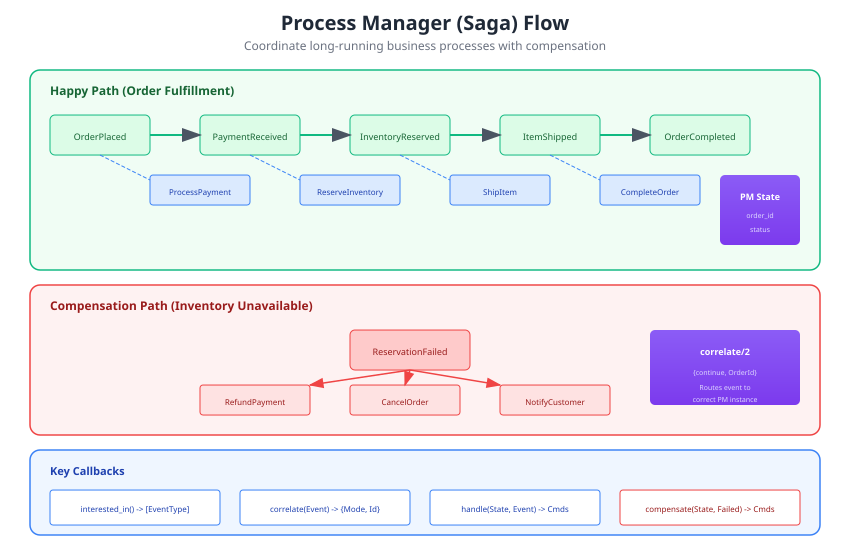

# Process Managers

Process managers coordinate long-running business processes that span multiple aggregates. They react to events and dispatch commands to drive workflows forward.

The reference material is explicit that a process manager is **not** a saga,
and these guides follow it: there is no saga module in evoq. What a process
manager can do on a failure is compensate, through its own `compensate/2`.



## When to Use Process Managers

Use process managers when:

- A business process spans **multiple aggregates**
- You need to **coordinate** a sequence of operations
- Failures require **compensation** (rollback)
- The process has **state** that persists across events

Examples:
- Order fulfillment (payment → inventory → shipping)
- User onboarding (account → profile → welcome email)
- Money transfer (debit source → credit destination)

## Basic Process Manager

```erlang
-module(order_fulfillment_pm).
-behaviour(evoq_process_manager).

-export([interested_in/0, correlate/2, handle/3, apply/2]).

%% Events this process manager reacts to
interested_in() ->
    [<<"OrderPlaced">>, <<"PaymentReceived">>, <<"InventoryReserved">>, <<"ItemShipped">>].

%% Route events to the correct process instance. The last event of the
%% process stops it; anything else is false, so correlate/2 never raises.
correlate(#{event_type := <<"ItemShipped">>, data := #{order_id := OrderId}}, _Metadata) ->
    {stop, OrderId};
correlate(#{data := #{order_id := OrderId}}, _Metadata) ->
    {continue, OrderId};
correlate(_Event, _Metadata) ->
    false.

%% React to events by dispatching commands
handle(State, #{event_type := <<"OrderPlaced">>} = Event, _Meta) ->
    OrderId = maps:get(order_id, maps:get(data, Event)),
    Amount = maps:get(amount, maps:get(data, Event)),

    %% Dispatch command to payment aggregate
    Cmd = evoq_command:new(process_payment, payment, OrderId, #{amount => Amount}),
    {ok, State#{status => awaiting_payment}, [Cmd]};

handle(State, #{event_type := <<"PaymentReceived">>}, _Meta) ->
    OrderId = maps:get(order_id, State),

    %% Dispatch command to inventory aggregate
    Cmd = evoq_command:new(reserve_inventory, inventory, OrderId, #{}),
    {ok, State#{status => awaiting_inventory}, [Cmd]};

handle(State, #{event_type := <<"InventoryReserved">>}, _Meta) ->
    OrderId = maps:get(order_id, State),

    %% Dispatch command to shipping aggregate
    Cmd = evoq_command:new(ship_item, shipping, OrderId, #{}),
    {ok, State#{status => awaiting_shipment}, [Cmd]};

handle(State, #{event_type := <<"ItemShipped">>}, _Meta) ->
    %% Process complete
    {ok, State#{status => completed}}.

%% Update process state from events
apply(State, #{event_type := <<"OrderPlaced">>, data := Data}) ->
    State#{
        order_id => maps:get(order_id, Data),
        customer_id => maps:get(customer_id, Data),
        items => maps:get(items, Data),
        status => started
    };
apply(State, _Event) ->
    State.
```

## Required Callbacks

### interested_in/0

Declare which event types this process manager reacts to:

```erlang
-spec interested_in() -> [EventType :: binary()].

interested_in() ->
    [<<"OrderPlaced">>, <<"PaymentFailed">>, <<"InventoryUnavailable">>].
```

The store subscription routes every event of these types to the process
manager, whether or not an event handler consumes them too. A process
manager started after the store subscription gets the history of its types
first, to it alone, and then the live events, each once and in store order.
History the node had consumed before it went down arrives as replay (see
below).

### correlate/2

Route events to the correct process instance:

```erlang
-spec correlate(Event :: map(), Metadata :: map()) ->
    {start, ProcessId :: binary()} |
    {continue, ProcessId :: binary()} |
    {stop, ProcessId :: binary()} |
    false.

%% Start a new process
correlate(#{event_type := <<"OrderPlaced">>, data := #{order_id := OrderId}}, _Meta) ->
    {start, OrderId};

%% Continue existing process
correlate(#{event_type := <<"PaymentReceived">>, data := #{order_id := OrderId}}, _Meta) ->
    {continue, OrderId};

%% Stop the process
correlate(#{event_type := <<"OrderCancelled">>, data := #{order_id := OrderId}}, _Meta) ->
    {stop, OrderId};

%% Ignore event (no matching process)
correlate(_, _) ->
    false.
```

A process instance belongs to its process manager: the ProcessId names an
instance of THIS process manager only. Two process managers that correlate
on the same id (both on an order id, say) each get their own instance and
their own state. Before 1.26.0 instances were found by event type and id
alone, so they could reach each other's instance.

Every event of a PM's types is delivered to it as long as some event
handler also consumes that type: the store subscription routes a type only
when a handler holds it (evoq #2). A type only a process manager declares is
not delivered yet; until that is fixed, give such a type a handler.

### handle/3

React to events and optionally dispatch commands:

```erlang
-spec handle(State :: term(), Event :: map(), Metadata :: map()) ->
    {ok, NewState :: term()} |
    {ok, NewState :: term(), Commands :: [map()]}.

%% Just update state
handle(State, #{event_type := <<"OrderPlaced">>}, _Meta) ->
    {ok, State#{started_at => erlang:system_time()}};

%% Update state and dispatch commands
handle(State, #{event_type := <<"PaymentReceived">>, data := #{order_id := OrderId}}, _Meta) ->
    Cmd1 = evoq_command:new(reserve_inventory, inventory, OrderId, #{}),
    Cmd2 = evoq_command:new(notify_warehouse, warehouse, OrderId, #{}),
    {ok, State#{payment_received => true}, [Cmd1, Cmd2]}.
```

### apply/2

Update process state from events. The runtime calls `handle/3` first, then
`apply/2` on the state `handle/3` returned, so `handle/3` sees the state as it
was before this event:

```erlang
-spec apply(State :: term(), Event :: map()) -> NewState :: term().

apply(State, #{event_type := <<"OrderPlaced">>, data := Data}) ->
    State#{
        order_id => maps:get(order_id, Data),
        total => maps:get(total, Data)
    };
apply(State, #{event_type := <<"PaymentReceived">>, data := #{amount := Amount}}) ->
    State#{paid_amount => Amount}.
```

## Compensation (Rollback)

When a command the process manager dispatched fails, the instance stops
dispatching the rest of that batch, runs the process manager's `compensate/2`
with the failed command, and dispatches what it returns, in order.

A process manager that exports `compensate/2` also gets the commands it did
dispatch recorded in its state (`executed_commands`, most recent first, read
with `evoq_pm_compensation:get_executed_commands/1`), cleared once the
compensation has run. It is in memory only and does not survive a restart -
keep anything a compensation must know across a restart in your own state,
rebuilt in `apply/2`.

```erlang
-module(money_transfer_pm).
-behaviour(evoq_process_manager).

-include_lib("evoq/include/evoq.hrl").

-export([interested_in/0, correlate/2, handle/3, apply/2, compensate/2]).

interested_in() ->
    [<<"TransferInitiated">>, <<"SourceDebited">>, <<"DestinationCreditFailed">>].

correlate(#{data := #{transfer_id := TransferId}}, _Meta) ->
    {continue, TransferId};
correlate(_Event, _Meta) ->
    false.

handle(State, #{event_type := <<"TransferInitiated">>, data := Data}, _Meta) ->
    %% Step 1: Debit source account, keeping what step 2 needs in the
    %% process's own state.
    Cmd = evoq_command:new(debit, account, maps:get(source_id, Data),
                           #{amount => maps:get(amount, Data)}),
    {ok, State#{status => debiting_source,
                source_id => maps:get(source_id, Data),
                dest_id => maps:get(dest_id, Data),
                amount => maps:get(amount, Data)}, [Cmd]};

handle(State, #{event_type := <<"SourceDebited">>}, _Meta) ->
    %% Step 2: Credit destination account
    Cmd = evoq_command:new(credit, account, maps:get(dest_id, State),
                           #{amount => maps:get(amount, State)}),
    {ok, State#{status => crediting_dest}, [Cmd]};

handle(State, #{event_type := <<"DestinationCreditFailed">>}, _Meta) ->
    %% Credit failed - need to compensate
    {ok, State#{status => compensating}}.

apply(State, _Event) ->
    State.

%% Compensation callback. The failed command arrives as the evoq_command
%% record the process manager returned - it is a #evoq_command{}, not a map.
-spec compensate(State :: term(), FailedCommand :: #evoq_command{}) ->
    {ok, CompensatingCommands :: [#evoq_command{}]} | skip.

compensate(#{source_id := SourceId, amount := Amount},
           #evoq_command{command_type = credit}) ->
    %% Credit failed, refund the source account
    RefundCmd = evoq_command:new(credit, account, SourceId, #{
        amount => Amount,
        reason => <<"transfer_failed">>
    }),
    {ok, [RefundCmd]};

compensate(_, _) ->
    skip.
```

## A Deadline of Your Own: handle_info/2

A process manager that has a deadline to keep (a clock that flags a player
who ran out of time, a bid that expires) schedules a message to itself,
and until this callback existed the instance dropped it: the deadline was
scheduled and never arrived. Declare the optional callback and the message
lands:

```erlang
-module(game_clock_pm).
-behaviour(evoq_process_manager).

-export([interested_in/0, correlate/2, handle/3, apply/2, handle_info/2]).

interested_in() ->
    [<<"game_started_v1">>].

correlate(#{data := #{game_id := GameId}}, _Meta) ->
    {continue, GameId};
correlate(_Event, _Meta) ->
    false.

apply(State, _Event) ->
    State.

handle(State, #{event_type := <<"game_started_v1">>, data := Data}, _Meta) ->
    %% What is left on the mover's clock, from the event, not from a read model.
    erlang:send_after(maps:get(mover_ms, Data), self(), {deadline, maps:get(mover, Data)}),
    {ok, State#{mover => maps:get(mover, Data)}};

handle(State, _Event, _Meta) ->
    {ok, State}.

handle_info({deadline, Player}, State) ->
    %% Commands returned here are dispatched exactly as handle/3's are.
    {noreply, State#{flagged => Player}, [flag_clock_cmd(Player)]};
handle_info(Other, State) ->
    %% Keep it total: an unmatched message must not take the instance down.
    {noreply, State#{last_ignored => Other}}.

flag_clock_cmd(Player) ->
    evoq_command:new(flag_clock, clock, Player, #{}).
```

The return shape is `{noreply, NewState}`, `{noreply, NewState, Commands}`
or `{stop, Reason, NewState}`. Three things about it:

- **The atom `timeout` is evoq's own idle timer and is never forwarded.**
  It is matched before the callback, so pick any other tag for your own
  timer.
- **A PM without `handle_info/2` that is sent a message logs a warning
  naming itself and the message**, rather than losing it quietly. Silence
  is what hid this gap for so long.
- **Check `replaying` before scheduling.** Replay runs `handle/3` again,
  and a `send_after` there schedules a second timer. The deadline itself
  must still be rebuilt from the events' own timestamps, and the resulting
  command must be safe to arrive twice: an instance whose `apply/2` state
  says the game already ended ignores a deadline that fires again.

## Restarts and Replay

Process manager instances live in memory, so after a restart they are
rebuilt by replaying history: every event the node had already consumed
before it went down comes around again with `replaying => true` in the
metadata.

For replay, `handle/3` and `apply/2` both run, so an instance rebuilds
exactly the state it had, including state kept in `handle/3` as in the
state machine pattern below. **The commands `handle/3` returns are not
dispatched**: the process manager already reacted to that event, and
dispatching again would re-issue its whole history on every restart.

Events appended while the node was down were never delivered, arrive
without `replaying`, and are handled and dispatched normally.

If `handle/3` has a side effect of its own rather than returning a
command, check `maps:get(replaying, Metadata, false)` before performing
it. After a crash, up to 199 events delivered since the last acknowledged
checkpoint arrive as new again, so commands should still be idempotent.

## State Machine Pattern

Process managers naturally model state machines:

```erlang
-module(order_state_machine_pm).
-behaviour(evoq_process_manager).

-export([interested_in/0, correlate/2, handle/3, apply/2]).

interested_in() ->
    [<<"OrderPlaced">>, <<"PaymentReceived">>, <<"PaymentFailed">>, <<"ItemShipped">>].

correlate(#{data := #{order_id := OrderId}}, _Meta) ->
    {continue, OrderId};
correlate(_Event, _Meta) ->
    false.

apply(State, _Event) ->
    State.

%% State transitions
handle(#{status := new} = State, #{event_type := <<"OrderPlaced">>}, _) ->
    {ok, State#{status => awaiting_payment}, [process_payment_cmd(State)]};

handle(#{status := awaiting_payment} = State, #{event_type := <<"PaymentReceived">>}, _) ->
    {ok, State#{status => awaiting_shipment}, [ship_order_cmd(State)]};

handle(#{status := awaiting_payment} = State, #{event_type := <<"PaymentFailed">>}, _) ->
    {ok, State#{status => cancelled}, [notify_customer_cmd(State)]};

handle(#{status := awaiting_shipment} = State, #{event_type := <<"ItemShipped">>}, _) ->
    {ok, State#{status => completed}};

%% Invalid transition - ignore
handle(State, _Event, _Meta) ->
    {ok, State}.

%% The commands this manager issues, each addressed by the order in its own
%% state.
process_payment_cmd(#{order_id := OrderId}) ->
    evoq_command:new(process_payment, payment, OrderId, #{}).

ship_order_cmd(#{order_id := OrderId}) ->
    evoq_command:new(ship_item, shipping, OrderId, #{}).

notify_customer_cmd(#{order_id := OrderId}) ->
    evoq_command:new(notify_customer, notification, OrderId, #{}).
```

## Instance Lifetime

An instance lives in memory until a `{stop, Id}` event ends it. The idle
timer only logs; it is not a timeout callback, and `timeout` is never
forwarded to your `handle_info/2` (see "A Deadline of Your Own"). A process
that never reaches a `{stop, Id}` keeps one process per id for the life of
the node, so give every process a terminal event, and design ones that can
stall so that something (a scheduled message to your own `handle_info/2`,
another aggregate's event) produces it.

- `{start, Id}` always starts a new instance, even when one exists for that
  id; use `{continue, Id}` unless the event genuinely begins a new process.
  The earlier instance keeps running, and receives that id's events again
  once the newer one stops.
- `{stop, Id}` hands the event to the running instance and stops it. When no
  instance exists for the id, the event is dropped: a process whose first
  event would be a stop never sees it.
- Instances are node-local. With the same process manager on several
  nodes, each node routes an event to its own instance for the id, or
  starts one, and a `{stop, Id}` stops only that node's instance; no node
  hands an event to another node's instance (evoq #10). Each node that
  consumes the store therefore runs its own instance of every process:
  if a process must run once in the cluster, run its process manager on
  one node.
- A crash in one process manager's `correlate/2`, `handle/3` or `apply/2`
  stays its own: the router logs `evoq_process_manager_failed`, emits
  `[evoq, process_manager, exception]`, keeps the event as a dead letter of
  that process manager, and goes on routing it to the others. An instance
  that crashed is gone; the next event for its id starts a new one, which
  does not have the old one's state. A router that restarts anyway routes
  to every process manager registered before (evoq #9). A catch-all
  `correlate(_, _) -> false` is still the way to say an event is not
  yours, rather than leaving a dead letter for it.

## Correlation Strategies

### By Entity ID

Most common - route by the main entity:

```erlang
correlate(#{data := #{order_id := OrderId}}, _) ->
    {continue, OrderId}.
```

### By Correlation ID

Use metadata for cross-aggregate correlation:

```erlang
correlate(_Event, #{correlation_id := CorrelationId}) ->
    {continue, CorrelationId}.
```

### Composite Key

When multiple entities involved:

```erlang
correlate(#{data := #{source := Src, dest := Dst}}, _) ->
    {continue, <<"transfer:", Src/binary, ":", Dst/binary>>}.
```

## Testing Process Managers

Test the state machine in isolation:

```erlang
-module(order_pm_tests).
-include_lib("eunit/include/eunit.hrl").

%% The events the process manager reacts to, as the store delivers them.
order_placed_event() ->
    #{event_type => <<"OrderPlaced">>,
      data => #{order_id => <<"order-1">>, total => 100}}.

payment_received_event() ->
    #{event_type => <<"PaymentReceived">>,
      data => #{order_id => <<"order-1">>, amount => 100}}.

item_shipped_event() ->
    #{event_type => <<"ItemShipped">>,
      data => #{order_id => <<"order-1">>}}.

full_workflow_test() ->
    %% Initial state
    State0 = #{},

    %% Order placed
    %% The runtime's order: handle/3 on the state so far, then apply/2 on
    %% the state it returned.
    {start, OrderId} = order_pm:correlate(order_placed_event(), #{}),
    {ok, Handled1, [PaymentCmd]} = order_pm:handle(State0, order_placed_event(), #{}),
    State2 = order_pm:apply(Handled1, order_placed_event()),

    ?assertEqual(awaiting_payment, maps:get(status, State2)),
    ?assertEqual(process_payment, maps:get(command_type, PaymentCmd)),

    %% Payment received
    {ok, Handled2, [ShipCmd]} = order_pm:handle(State2, payment_received_event(), #{}),
    State4 = order_pm:apply(Handled2, payment_received_event()),

    ?assertEqual(awaiting_shipment, maps:get(status, State4)),
    ?assertEqual(ship_item, maps:get(command_type, ShipCmd)),

    %% Item shipped
    {ok, Handled3} = order_pm:handle(State4, item_shipped_event(), #{}),
    State6 = order_pm:apply(Handled3, item_shipped_event()),

    ?assertEqual(completed, maps:get(status, State6)).
```

## Telemetry Events

Process managers emit telemetry:

| Event | Measurements | Metadata |
|-------|--------------|----------|
| `[evoq, process_manager, start]` | (none) | pm_module, process_id |
| `[evoq, process_manager, stop]` | (none) | pm_module, process_id |
| `[evoq, process_manager, command]` | (none) | pm_module, process_id, command_type |
| `[evoq, process_manager, compensate]` | command_count | pm_module, process_id |
| `[evoq, process_manager, exception]` | (none) | pm_module, event_type, error |

## Best Practices

### 1. Keep Processes Short-Lived

Long-running processes accumulate state and risk:
- Design for completion in minutes/hours, not days
- Split long workflows into smaller processes
- Give every process a terminal event that correlates as `{stop, Id}`
  (see Instance Lifetime)

### 2. Make Steps Idempotent

Commands may be dispatched multiple times:

```erlang
handle(State, Event, _Meta) ->
    case already_dispatched(Event, State) of
        true -> {ok, State};
        false ->
            Cmd = create_command(Event),
            {ok, mark_dispatched(Event, State), [Cmd]}
    end.
```

### 3. Handle All Failure Modes

```erlang
interested_in() ->
    [
        %% Happy path
        <<"OrderPlaced">>, <<"PaymentReceived">>, <<"ItemShipped">>,
        %% Failure cases
        <<"PaymentFailed">>, <<"InventoryUnavailable">>, <<"ShippingFailed">>
    ].
```

### 4. Log State Transitions

```erlang
handle(State, Event, _Meta) ->
    OldStatus = maps:get(status, State),
    {ok, NewState, Cmds} = do_handle(State, Event),
    NewStatus = maps:get(status, NewState),

    logger:info("Process ~p: ~p -> ~p on ~p",
        [maps:get(process_id, State), OldStatus, NewStatus, maps:get(event_type, Event)]),

    {ok, NewState, Cmds}.
```

## Next Steps

- [Projections](projections.md) - Build read models
- [Event Handlers](event_handlers.md) - Side effects
- [Architecture](architecture.md) - System overview
