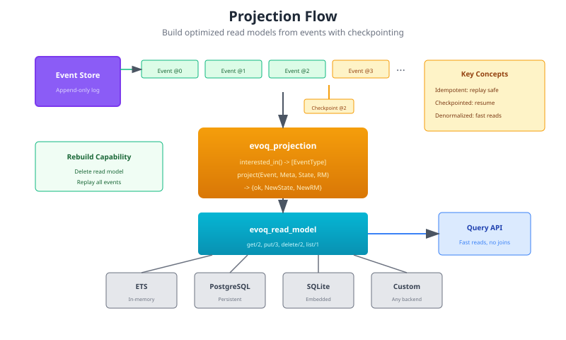

# Projections

Projections build read models from events. They transform the event stream into optimized views for queries, enabling fast reads without impacting write performance.



## When to Use Projections

Use projections for:

- **Query-optimized views** - Denormalized data for fast reads
- **Aggregated data** - Counts, sums, statistics
- **Cross-aggregate views** - Data from multiple aggregates
- **Search indexes** - Full-text search, filtering

The key insight: read models can be **rebuilt** by replaying events.

## Understanding Event Envelope Structure

**IMPORTANT:** `project/4` takes the event as its first argument and the
delivered metadata as its second. The event is a flat map:

```erlang
#{
    event_type => <<"order_placed_v1">>,  %% Event type (binary)
    data => #{                             %% ← YOUR BUSINESS EVENT PAYLOAD
        order_id => <<"ord-123">>,
        customer_id => <<"cust-456">>,
        total => 99.99,
        items => [<<"item-1">>, <<"item-2">>]
    },
    tags => [<<"tenant:acme">>],
    timestamp => 1703001234567             %% ← read the time from here
}.
```

and the metadata is the routing envelope:

```erlang
#{
    stream_id => <<"order-018f6a7b8c9d4e5f60718293a4b5c6d9">>,      %% the stream the event was appended to
    version => 7,                          %% the subscription's per-boot counter
    stream_version => 3,                   %% the event's version in its stream
    global_position => 412,                %% its index in the store's global log
    event_id => <<"01J8...">>,
    correlation_id => <<"req-abc">>,       %% lineage, see evoq_lineage
    causation_id => <<"cmd-xyz">>
}.
```

**Key fields:**
- `event_type` - Binary identifying the event type
- `data` - **Your business event payload** (extract this)
- `metadata` - Cross-cutting metadata (correlation_id, causation_id, etc.)
- `tags` - Optional tags for cross-stream queries

The second parameter (`Metadata`) is the envelope metadata, duplicated for convenience.

**See [Event Envelope Guide](event_envelope.md) for complete details.**

## Basic Projection

```erlang
-module(order_summary_projection).
-behaviour(evoq_projection).

-export([interested_in/0, init/1, project/4]).

%% Events this projection processes
interested_in() ->
    [<<"OrderPlaced">>, <<"OrderShipped">>, <<"OrderCancelled">>].

%% Initialize projection with a read model backend
init(_Config) ->
    {ok, ReadModel} = evoq_read_model:new(evoq_read_model_ets, #{}),
    {ok, #{}, ReadModel}.

%% Project each event into the read model. The read model is keyed on the
%% order, which comes from the event's data: stream_id names the stream
%% (<<"order-018f6a7b8c9d4e5f60718293a4b5c6d9">>), not the order.
project(#{event_type := <<"OrderPlaced">>, data := Data} = Event, Metadata, State, ReadModel) ->
    OrderId = maps:get(order_id, Data),
    Summary = #{
        order_id => OrderId,
        customer_id => maps:get(customer_id, Data),
        total => maps:get(total, Data),
        items => maps:get(items, Data),
        status => placed,
        placed_at => maps:get(timestamp, Event)
    },
    {ok, NewRM} = evoq_read_model:put(OrderId, Summary, ReadModel),
    {ok, State, NewRM};

project(#{event_type := <<"OrderShipped">>, data := Data} = Event, Metadata, State, ReadModel) ->
    OrderId = maps:get(order_id, Data),
    case evoq_read_model:get(OrderId, ReadModel) of
        {ok, Summary} ->
            Updated = Summary#{
                status => shipped,
                tracking_number => maps:get(tracking_number, Data),
                shipped_at => maps:get(timestamp, Event)
            },
            {ok, NewRM} = evoq_read_model:put(OrderId, Updated, ReadModel),
            {ok, State, NewRM};
        {error, not_found} ->
            %% Order not found - skip
            {skip, State, ReadModel}
    end;

project(#{event_type := <<"OrderCancelled">>, data := Data} = Event, Metadata, State, ReadModel) ->
    OrderId = maps:get(order_id, Data),
    case evoq_read_model:get(OrderId, ReadModel) of
        {ok, Summary} ->
            Updated = Summary#{
                status => cancelled,
                cancelled_at => maps:get(timestamp, Event)
            },
            {ok, NewRM} = evoq_read_model:put(OrderId, Updated, ReadModel),
            {ok, State, NewRM};
        {error, not_found} ->
            {skip, State, ReadModel}
    end.
```

## Required Callbacks

### interested_in/0

Declare which event types to process:

```erlang
-spec interested_in() -> [EventType :: binary()].

interested_in() ->
    [<<"UserRegistered">>, <<"ProfileUpdated">>, <<"UserDeactivated">>].
```

### init/1

Initialize projection state and read model:

```erlang
-spec init(Config :: map()) ->
    {ok, State :: term(), ReadModel :: term()} |
    {error, Reason :: term()}.

init(Config) ->
    %% Choose read model backend
    Backend = maps:get(backend, Config, evoq_read_model_ets),
    {ok, ReadModel} = evoq_read_model:new(Backend, Config),

    %% Initial state
    State = #{
        events_processed => 0,
        last_event_time => undefined
    },

    {ok, State, ReadModel}.
```

### project/4

Transform an event into read model updates:

```erlang
-spec project(Event :: map(), Metadata :: map(), State :: term(), ReadModel :: term()) ->
    {ok, NewState :: term(), NewReadModel :: term()} |
    {skip, State :: term(), ReadModel :: term()}.

project(Event, Metadata, State, ReadModel) ->
    %% Event: #{event_type => ..., data => ..., timestamp => ...}
    %% Metadata: #{stream_id => ..., version => ..., global_position => ...}

    %% Update read model
    {ok, NewRM} = update_read_model(Event, ReadModel),

    %% Update projection state
    NewState = State#{
        events_processed => maps:get(events_processed, State) + 1,
        last_event_time => maps:get(timestamp, Event)
    },

    {ok, NewState, NewRM}.
```

## Read Model Backends

evoq provides a `evoq_read_model` abstraction with multiple backends:

### ETS (In-Memory)

Fast, volatile storage. Good for caching and development.

```erlang
init(_Config) ->
    {ok, RM} = evoq_read_model:new(evoq_read_model_ets, #{
        name => order_summaries
    }),
    {ok, #{}, RM}.
```

### A persistent backend

`evoq` ships one read model backend, `evoq_read_model_ets`. SQL, DETS or an
external store is a backend you implement (next section) and start the
projection with:

```erlang
init(Config) ->
    {ok, RM} = evoq_read_model:new(my_postgres_read_model, #{
        pool => my_pool,
        table => <<"order_summaries">>
    }),
    {ok, #{}, RM}.
```

### Custom Backend

Implement the `evoq_read_model` behavior:

```erlang
-module(my_custom_read_model).
-behaviour(evoq_read_model).

-export([init/1, get/2, put/3, delete/2, list/2, clear/1]).

%% A read model's state is whatever the store keeps; here, one map of
%% key to value.
init(Config) ->
    {ok, #{config => Config, data => #{}}}.

get(Key, #{data := Data}) ->
    case maps:find(Key, Data) of
        {ok, Value} -> {ok, Value};
        error -> {error, not_found}
    end.

put(Key, Value, #{data := Data} = State) ->
    {ok, State#{data => Data#{Key => Value}}}.

delete(Key, #{data := Data} = State) ->
    {ok, State#{data => maps:remove(Key, Data)}}.

%% Optional: without them a rebuild cannot clear, and list returns
%% {error, not_implemented}
list(Prefix, #{data := Data}) ->
    {ok, [{K, V} || {K, V} <- maps:to_list(Data), under(Prefix, K)]}.

clear(State) ->
    {ok, State#{data => #{}}}.

under(Prefix, Key) when is_binary(Prefix), is_binary(Key) ->
    binary:longest_common_prefix([Prefix, Key]) =:= byte_size(Prefix);
under(Prefix, Key) ->
    Prefix =:= Key.
```

## Checkpointing

A projection records the position of the last event it projected, after
every event, and skips any event at or below it as already projected. With
no checkpoint store the position lives in the process and starts at -1 on
every boot, which suits an in-memory read model rebuilt from the store on
each start. A read model that survives a restart needs a checkpoint store
that survives it too:

```erlang
evoq_projection:start_link(order_summary_projection, #{},
                           #{checkpoint_store => my_checkpoint_store}).
```

The store implements `evoq_checkpoint_store` (`load/1`, `save/2`,
`delete/1`). `evoq_checkpoint_store_ets` keeps it in ETS, which does not
survive a node restart either.

A checkpoint store goes only with a **durable** read model, one whose module
exports `durable() -> true`. The checkpoint says "everything up to here is in
the read model"; kept across a restart next to rows that were not, it skips
the whole history and the read model comes back empty, without a word. So a
projection whose read model is not durable refuses a checkpoint store at
start:

```erlang
{error, {checkpoint_outlives_read_model, order_summary_projection, evoq_read_model_ets}}
```

`evoq_read_model_ets` answers `false`: its table belongs to the projection
process, so its rows go even when only the projection restarts, and the
node-wide `evoq_checkpoint_store_ets` outlives it. A read model without
`durable/0` counts as not durable. A database-backed read model exports
`durable() -> true`.

The projection's own state (the `State` that `init/1` returns) starts fresh
on every start as well. Keep in it nothing the checkpoint claims is
projected; that belongs in the read model.

A checkpoint save is a **second write**. The read model rows are written
first, then the checkpoint; a crash between the two leaves the read model
ahead of the checkpoint, so the last event may be projected again on the next
boot. Delivery is therefore at-least-once, not exactly-once: make
`project/4` idempotent (put, do not increment a counter you read back
blindly) and expect the last event to repeat after a crash.

### What the position is

Events from the store subscription carry `global_position` in their
metadata: the event's index in the store's global log. It is what the
checkpoint holds. A rebuild delivers the same `global_position`, so a
checkpoint saved by a rebuild and one saved from the live feed agree.

It names the same event in every boot as long as the store keeps its global
order. With reckon-db that means `epoch_us` stamps monotone in commit order
(no clock stepping back, no cluster nodes with differing clocks, no two
concurrent appends committing in the reverse order of their stamps) and no
event ever removed from the store (`delete_stream`, `scavenge`). Each
violation moves the positions after it, and the next restart skips or
repeats that many events.

Live positions are counted, not read from the store, so a second delivery
of the same event (reckon-db may deliver one twice while its catch-up
overlaps its live trigger) would move every later one. The store
subscription drops an event whose id it consumed among the last 2000
before counting it.

What dropping duplicates does not cover is order. An event appended after
catch-up's last read and before reckon-db arms its live trigger arrives
through reckon-db's catch-up, possibly after an event appended just after
arming. The two are numbered in the wrong order, and a crash between
projecting them skips one and repeats the other on the next boot.

Before 1.25.0 the checkpoint held the subscription's per-boot counter,
`version` in the metadata, which restarts at 0 and counts only events that
have a handler. When the set of handlers changed between boots, a saved
checkpoint pointed at a different event: events appended while the node was
down were skipped, or projected events were projected again. `version` is
still there for anything that reads it; do not persist it. A checkpoint
saved by 1.24.x makes the first boot of 1.25.0 project part of the history
again (never skip): delete it before upgrading, or rebuild after.

Events handed to `evoq_projection:notify/4` directly have no
`global_position` and are checkpointed on `version`. The two numbers are not
comparable, so a projection takes its events from one source, never both.

### A projection that starts after the store subscription

A projection whose handler registers after the store subscription's
catch-up (every projection in an application that boots after the one that
owns the store) gets its history through backfill: one pass over the store,
in global order, for all the types it registers that had no handler yet.

Backfill runs only for a type's first handler ever. A projection on a type
another handler already covers gets no history of that type at all.

Worse, a projection on a covered type and a new one can lose history it
would have got on 1.24.2. Handler H on [B] registers, then projection P on
[B, C]: H's pass over B delivers B's history to P too and moves P's
checkpoint to B's last position, and P's own pass over C then skips every
C event below it. The same happens when a projection registers during
catch-up for a type catch-up already delivers.

Both are left for evoq 2.0.0 (evoq #4), which backfills per registrant, all
its types, to it alone. Until then, start the store subscription after every
handler has registered (from the application listed last in the release),
so catch-up delivers everything in store order and no backfill runs, or
call `evoq_projection:rebuild/1` once the projection is registered.

## Handling Projection Errors

A projection's `project/4` can answer `{error, Reason}`. That is handled
exactly as an event handler's failure is: the optional `on_error/4` decides
between `retry`, `{retry, DelayMs}`, `skip`, `stop` and
`{dead_letter, Reason}`, and without it the framework's default applies -
backoff, then dead letter after `max_retries/0` attempts.

```erlang
-spec on_error(term(), map(), #evoq_failure_context{}, term()) ->
    evoq_error_handler:error_action().

on_error(Reason, _Event, #evoq_failure_context{attempt_number = Attempt}, _State) ->
    case Attempt >= 3 of
        true -> {dead_letter, Reason};
        false -> {retry, 500}
    end.
```

What each action does to the checkpoint:

| Action | Checkpoint | Event comes back? |
|--------|-----------|-------------------|
| `retry`, `{retry, D}` | unchanged | yes, immediately (or after D) |
| `skip` | advanced | no - the projection said it does not want it |
| `{dead_letter, R}` | advanced | no - stored for an operator (`evoq_dead_letter:list/0`) |
| `stop` | unchanged | **not automatically** - see below |

`on_error/4` is used as given: it replaces the default policy including its
retry cap, so an `on_error/4` that always answers `retry` retries forever,
inside the projection's process, and `{retry, D}` sleeps there, holding up
every event behind it. Bound it yourself, with
`FailureContext#evoq_failure_context.attempt_number` or your own state.

The default (no `on_error/4`) is bounded: `max_retries/0` attempts
(5 unless the module says otherwise) with `evoq_retry_strategy`'s backoff,
which adds up to a few seconds per failing event before it is dead-lettered.

**`stop` ends the process.** The node's shared `$all` subscription has
already acknowledged past the event, so the feed will not hand it back. A
restart resumes from the projection's checkpoint, replaying what it missed
from the store; a projection with no checkpoint store has nothing to resume
from and needs `evoq_projection:rebuild/1`.

`skip` and `{dead_letter, _}` are logged with the event id and the position,
so a silent gap is not possible: a check that the read model is behind shows
up in the log.

### A projection that comes up halted and behind

A projection never refuses to boot. It catches up at start in two passes -
one before it registers (so a long catch-up does not hold up the node's
event router), one after, from the position the first pass reached. The
second pass runs while registered, so the router waits on it for the length
of the second pass; that is bounded by what was appended while the first pass
ran, which is nothing at all for a projection whose first pass was short. If
either pass stops on an event - the `stop` action above, or a `raise` in
`project/4`, which is reported exactly like an `{error, _}` - the projection
comes up **halted and behind**:

- the checkpoint is the one the replay actually reached; nothing after it is
  projected, and the checkpoint never moves past it;
- `halted` in its state carries the reason, so every later event is answered
  `{error, {halted, Reason}}` instead of being projected (the event router
  logs that reply as `evoq_handler_returned_error`). Without this the next
  successful event would move the checkpoint past the event the projection
  refused, and the gap would be permanent and silent;
- it says so once: a log line with
  `what => evoq_projection_halted_behind`, the `projection` module and the
  `error`, and the `[evoq, projection, halted]` telemetry event with the
  same metadata. (Once, not twice: a halt in the first pass skips the
  second, which would halt on the same event.)

Refusing to start would turn one poison event into a restart loop and, for a
statically supervised projection, into a failed application boot. Coming up
halted keeps the failure where the event is.

The way out is a rebuild, once the cause is fixed - repair the data, or ship
the projection fix:

```erlang
ok = evoq_projection:rebuild(ProjectionPid).
```

That clears the read model, sets the checkpoint back to -1 and replays
everything (see the next section), and on success it clears `halted`. Until
then the checkpoint does not advance, which is visible in
`[evoq, projection, checkpoint]`.

A rebuild of a projection whose `init/1` fails stops the process rather than
serving the old state over an emptied read model; the supervisor restarts it
and `init/1` runs again.

## Rebuilding Projections

A rebuild clears the read model, sets the checkpoint back to -1, and
replays every event of the projection's types from the store, page by page
through the global log, so it is not capped at one read batch. It also runs
`init/1` again, so the projection's own state starts as empty as the read
model: without that, the replay landed on top of state that already
reflected it and counted every event twice.

```erlang
ok = evoq_projection:rebuild(ProjectionPid).
```

The page size is the `replay_batch_size` application setting (default 1000).
The events and metadata a rebuild hands to `project/4` have the same shape
as the store subscription's, with `replaying => true` added.

This is powerful:
- Fix bugs in projection logic
- Add new fields to read model
- Migrate to a new storage backend
- Test projection changes safely

Two things to know about `init/1` running again:

- A backend that allocates a resource in `init/1` allocates one per
  rebuild. The ETS backend takes a `name`, and a named table is reused, so
  `#{name => order_summaries}` is what keeps rebuilds from leaving an
  anonymous table behind each time.
- If `init/1` fails during a rebuild the read model has already been
  cleared, so the projection stops rather than serve events from state that
  no longer matches the data. It comes back on restart with a fresh
  `init/1` state; the read model is empty until it catches up or is
  rebuilt again.

## Cross-Aggregate Projections

Projections can combine data from multiple aggregates:

```erlang
-module(customer_orders_projection).
-behaviour(evoq_projection).

interested_in() ->
    [<<"CustomerRegistered">>, <<"OrderPlaced">>, <<"OrderShipped">>].

project(#{event_type := <<"CustomerRegistered">>, data := Data}, Meta, State, RM) ->
    CustomerId = maps:get(customer_id, Data),
    Customer = #{
        customer_id => CustomerId,
        name => maps:get(name, Data),
        email => maps:get(email, Data),
        orders => [],
        total_spent => 0
    },
    {ok, NewRM} = evoq_read_model:put(CustomerId, Customer, RM),
    {ok, State, NewRM};

project(#{event_type := <<"OrderPlaced">>, data := Data}, _Meta, State, RM) ->
    CustomerId = maps:get(customer_id, Data),
    case evoq_read_model:get(CustomerId, RM) of
        {ok, Customer} ->
            OrderSummary = #{
                order_id => maps:get(order_id, Data),
                total => maps:get(total, Data),
                status => placed
            },
            Updated = Customer#{
                orders => [OrderSummary | maps:get(orders, Customer)],
                total_spent => maps:get(total_spent, Customer) + maps:get(total, Data)
            },
            {ok, NewRM} = evoq_read_model:put(CustomerId, Updated, RM),
            {ok, State, NewRM};
        {error, not_found} ->
            {skip, State, RM}
    end.
```

## Aggregation Projections

Build statistics and summaries:

```erlang
-module(daily_stats_projection).
-behaviour(evoq_projection).

interested_in() ->
    [<<"OrderPlaced">>, <<"OrderCancelled">>].

project(#{event_type := <<"OrderPlaced">>, data := Data} = Event, Meta, State, RM) ->
    Date = date_from_timestamp(maps:get(timestamp, Event)),

    Stats = case evoq_read_model:get(Date, RM) of
        {ok, Existing} -> Existing;
        {error, not_found} -> #{orders => 0, revenue => 0, cancelled => 0}
    end,

    Updated = Stats#{
        orders => maps:get(orders, Stats) + 1,
        revenue => maps:get(revenue, Stats) + maps:get(total, Data)
    },

    {ok, NewRM} = evoq_read_model:put(Date, Updated, RM),
    {ok, State, NewRM}.

%% The event's timestamp is milliseconds since the epoch; the day is the
%% key this read model groups by.
date_from_timestamp(Ms) ->
    {{Y, M, D}, _Time} = calendar:system_time_to_universal_time(Ms, millisecond),
    {Y, M, D}.
```

## Querying Read Models

Query projections directly:

```erlang
%% Get single item
{ok, OrderSummary} = evoq_read_model:get(OrderId, ReadModel).

%% List every key (list/2, not list/1); a binary or tuple lists a prefix
{ok, AllOrders} = evoq_read_model:list(all, ReadModel).
```

Anything beyond a key lookup is your backend's own API: `evoq_read_model`
exposes `get/2`, `put/3`, `delete/2`, `list/2` and `clear/1`, and a SQL
backend adds its own query calls beside them.

## Testing Projections

Test projections with event sequences:

```erlang
-module(order_summary_projection_tests).
-include_lib("eunit/include/eunit.hrl").

project_order_lifecycle_test() ->
    %% Setup
    {ok, State0, RM0} = order_summary_projection:init(#{}),

    %% Order placed
    PlacedEvent = #{
        event_type => <<"OrderPlaced">>,
        data => #{customer_id => <<"cust-1">>, total => 100, items => []},
        timestamp => 1000
    },
    PlacedMeta = #{stream_id => <<"order-018f6a7b8c9d4e5f60718293a4b5c6d9">>},

    {ok, State1, RM1} = order_summary_projection:project(PlacedEvent, PlacedMeta, State0, RM0),

    %% Verify
    {ok, Summary1} = evoq_read_model:get(<<"order-018f6a7b8c9d4e5f60718293a4b5c6d9">>, RM1),
    ?assertEqual(placed, maps:get(status, Summary1)),
    ?assertEqual(100, maps:get(total, Summary1)),

    %% Order shipped
    ShippedEvent = #{
        event_type => <<"OrderShipped">>,
        data => #{tracking_number => <<"TRACK123">>},
        timestamp => 2000
    },
    ShippedMeta = #{stream_id => <<"order-018f6a7b8c9d4e5f60718293a4b5c6d9">>},

    {ok, _State2, RM2} = order_summary_projection:project(ShippedEvent, ShippedMeta, State1, RM1),

    %% Verify
    {ok, Summary2} = evoq_read_model:get(<<"order-018f6a7b8c9d4e5f60718293a4b5c6d9">>, RM2),
    ?assertEqual(shipped, maps:get(status, Summary2)),
    ?assertEqual(<<"TRACK123">>, maps:get(tracking_number, Summary2)).
```

## Telemetry Events

Projections emit telemetry:

| Event | Measurements | Metadata |
|-------|--------------|----------|
| `[evoq, projection, start]` | (none) | projection |
| `[evoq, projection, event]` | system_time | projection, event_type |
| `[evoq, projection, stop]` | duration | projection, event_type |
| `[evoq, projection, stop]` | (none) | projection (the projection process stopping) |
| `[evoq, projection, exception]` | duration | projection, event_type, error |
| `[evoq, projection, halted]` | (none) | projection, error |
| `[evoq, projection, checkpoint]` | (none) | projection, position |

`[evoq, projection, stop]` is emitted both per projected event (with a
duration) and when the projection process stops (without); tell them apart
by the `duration` measurement or the `event_type` metadata. A rebuild emits
no events of its own.

`[evoq, projection, checkpoint]` fires on every checkpoint save, with or
without a checkpoint store, and carries the position it saved. It is the
number that says whether a projection is still moving: a projection whose
checkpoint has stopped advancing is stuck, however quiet it is.

Units: `duration` is monotonic elapsed time and `system_time` is wall-clock
time, both in native units (convert with
`erlang:convert_time_unit(V, native, millisecond)`).

## Best Practices

### 1. Design for Queries

Think about how the data will be queried:

<!-- doc_snippets: skip a sketch: the shape of a projection clause, not a complete one -->
```erlang
%% Good - optimized for "get orders by customer"
project(Event, Meta, State, RM) ->
    CustomerId = maps:get(customer_id, Event),
    Key = {customer, CustomerId},
    %% One lookup per customer
    ...
```

### 2. Handle Missing Data

Events may arrive out of order or reference missing entities:

<!-- doc_snippets: skip a sketch: ParentId and NewRM come from the clause this one sits in -->
```erlang
project(Event, _Meta, State, RM) ->
    case evoq_read_model:get(ParentId, RM) of
        {ok, Parent} ->
            %% Update normally
            {ok, State, NewRM};
        {error, not_found} ->
            %% Parent doesn't exist - skip or create placeholder
            {skip, State, RM}
    end.
```

### 3. Monitor Lag

Track how far behind projections are:

<!-- doc_snippets: skip a sketch: NewRM comes from the clause this one sits in -->
```erlang
project(Event, Meta, State, RM) ->
    EventTime = maps:get(timestamp, Event),
    Lag = erlang:system_time(millisecond) - EventTime,

    telemetry:execute([my_app, projection, lag], #{lag_ms => Lag}, #{
        projection => ?MODULE
    }),

    %% Continue projecting...
    {ok, State, NewRM}.
```

### 4. Version Read Models

Support schema evolution:

<!-- doc_snippets: skip a sketch: Key and the migration helper come from the clause this one sits in -->
```erlang
project(Event, Meta, State, RM) ->
    {ok, Existing} = evoq_read_model:get(Key, RM),

    %% Migrate old format
    Migrated = case Existing of
        #{version := 1} -> migrate_v1_to_v2(Existing);
        #{version := 2} -> Existing;
        _ -> #{version => 2}  %% New record
    end,

    Updated = update_record(Migrated, Event),
    {ok, NewRM} = evoq_read_model:put(Key, Updated#{version => 2}, RM),
    {ok, State, NewRM}.
```

## Next Steps

- [Event Handlers](event_handlers.md) - Side effects
- [Process Managers](process_managers.md) - Orchestration
- [Architecture](architecture.md) - System overview
